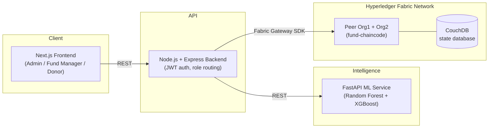

# Blockchain-Based Transparent Benevolent Fund Management System

**Real-Time Donor Impact Visibility for Sri Lankan Charitable Organizations**

BSc (Hons) Computing final-year research project — Coventry University / National Institute of Business Management (NIBM), Sri Lanka.

A permissioned-blockchain platform that lets charitable organizations manage benevolent funds transparently: every contribution, disbursement request, approval and outcome report is recorded immutably on a Hyperledger Fabric ledger, with an ML-assisted impact prediction step and a real-time donor-facing impact dashboard.

## Research objectives → what's implemented

1. **Role-based fund management web app** — Admin, Fund Manager and Donor roles can create/manage funds, contribute, and request/approve/reject disbursements through a secure, JWT-authenticated web app.
2. **Fund transparency via smart contracts** — a Hyperledger Fabric chaincode (`chaincode/fund-chaincode`) records every transaction on an immutable, tamper-proof ledger, queryable by any role with access (including full version history per asset).
3. **Real-time donor impact dashboard** — donors see quantified social impact (beneficiaries reached, impact-level mix) computed live from the ledger, not a static report.
4. **ML-based fund-utilization forecasting** — a Random Forest / XGBoost ensemble (`ml_service`), trained on National Secretariat for NGOs of Sri Lanka fund-disbursement data, predicts a disbursement's likely impact level before it reaches Admin approval.

## Architecture



## Tech stack

| Layer | Technology |
| --- | --- |
| Blockchain | Hyperledger Fabric 2.5.9 — 2-org test network, CouchDB state database, Fabric CA identity management |
| Chaincode | TypeScript (`fabric-contract-api` / `fabric-shim`) |
| Backend | Node.js + Express + `@hyperledger/fabric-gateway` + `@grpc/grpc-js` |
| ML service | Python + FastAPI + scikit-learn (Random Forest) + XGBoost |
| Frontend | Next.js 14 + TypeScript + Tailwind CSS + Recharts |

## Repository structure

```
backend/          Node/Express API — auth, role routing, Fabric Gateway integration
chaincode/         fund-chaincode — the TypeScript smart contract
fabric-network/    Scripts to install fabric-samples, bring up the test network, enroll role identities
frontend/          Next.js web app — Admin / Fund Manager / Donor dashboards
ml/                Trained model artifact (impact_model_v2.joblib)
ml_service/        FastAPI service that serves ML predictions to the backend
```

Each folder has its own `README.md` with full setup detail; this file is the quick-start and the big picture.

## Identity model

The network uses **one Fabric identity per role** (`fund-admin` / `Admin`, `fund-manager` / `FundManager`, `fund-donor` / `Donor`), not one per individual user. Individual accountability (which specific donor made a contribution) is handled at the application layer by the backend's own user table and JWT claims — the backend picks which of the three Fabric identities to sign a transaction with, based on the authenticated user's role, and records the real individual's ID inside the transaction payload. This keeps the chaincode's access-control model simple and auditable while still giving every user a traceable record on the ledger.

## Prerequisites

- Docker (with Docker Compose)
- Node.js 18+
- Python 3.10+
- Hyperledger Fabric binaries + `fabric-samples` (installed via `fabric-network/01_install_fabric_samples.sh`)

## Getting started

```bash
# 1. Install fabric-samples and the Fabric binaries (one-time)
./fabric-network/01_install_fabric_samples.sh

# 2. Bring up the 2-org Fabric test network, CouchDB, and deploy the chaincode
./fabric-network/02_bring_up_network.sh

# 3. Enroll the three role identities (Admin, FundManager, Donor)
./fabric-network/03_enroll_users.sh

# 4. Start the backend (reads the connection profile + identities from fabric-network/)
cd backend && npm install && npm run dev        # http://localhost:4000

# 5. Start the ML service
cd ml_service && python3 -m venv venv && source venv/bin/activate
pip install -r requirements.txt
uvicorn main:app --reload --port 8000           # http://localhost:8000

# 6. Start the frontend
cd frontend && npm install && npm run dev        # http://localhost:3000
```

Copy `backend/.env.example` → `backend/.env` and `frontend/.env.local.example` → `frontend/.env.local` and fill in your local values before starting those two.

## Roles

| Role | Can do |
| --- | --- |
| **Admin** | Create and close funds, approve or reject disbursement requests, view the full fund directory and ledger |
| **Fund Manager** | Request disbursements (triggers the ML impact prediction), record outcome reports once a disbursement is approved |
| **Donor** | Contribute to open funds, view a real-time personal and fund-wide impact dashboard |

## Security note

Fabric identity private keys (`fabric-network/identities/`) and `.env` / `.env.local` files are intentionally excluded from version control via `.gitignore`. Never commit these — they are local credentials, not code. Use the provided `.env.example` files as templates.

## Academic context

This repository is the software artifact for a BSc (Hons) Computing final-year thesis jointly awarded by Coventry University and the National Institute of Business Management (NIBM), Sri Lanka: *"A Blockchain-Based Transparent Benevolent Fund Management System with Real-Time Donor Impact Visibility for Sri Lankan Charitable Organizations."*
